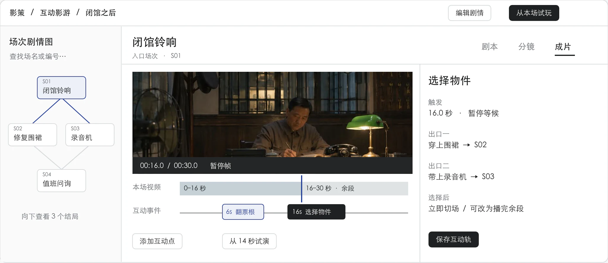

# 影策互动影游制作台 PRD

**版本 1.0 · 2026-11-19 · 设计已确认**　[查看配套设计稿](design.html)

编剧把一部小说改成能从头走到结局的剧本。导演沿用短剧的分镜与视频制作流程，拍好每一场，再在画面上安排观众行动的时机。制片与测试者需要回答两个问题：哪些场次还要拍？用不同方式走到同一场时，演员的回应是否接得上？

## 一、交付范围与现状

| 范围 | 本次评审口径 |
| --- | --- |
| 工程中已有基础 | 小说 TXT 或粘贴、两阶段改编、部分场次恢复、场次 DAG、按场投产、剧本 / 分镜 / 成片、剧情段精修、作者文字或视频试玩。当前播放器在场次视频结束后提供出口。这里的现状来自工作区静态核对。 |
| 本期拟增加 | 在本场成片中编辑互动轨；画面热点；片中选择与携带效果；汇合场按状态给出回应；从锚点或指定来路试演；换片后复核。 |
| 后续议题 | 面向观众的公开发行、付费、跨设备存档、可循环探索地图、多槽装备与战斗数值。 |

**验收目标**：用《闭馆之后》完成一条从小说到作者试玩的制作流程。两个入口选择经过同一问询场，抵达三种结局。导演可只移动时间点，编剧可只修改出口，制片能看出哪些媒体需要更新。样片只用于验证交互，内容时长、场数和结局数均为样例值。

## 二、作者工作流

| 编号与入口 | 作者动作 | 系统反馈与返回位置 |
| --- | --- | --- |
| R1 · 作品库 → 新建 | 导入 TXT 或粘贴，生成改编方向，改写人物目标、关键抉择与结局，再确认生成剧情图。 | 显示读取状态、输出进度与已恢复场数。中断可保存完整场次，再续写缺口。重生成提示受影响的手工编辑；计价生成在发起前展示任务范围。 |
| R2 · 编辑剧情 | 指定唯一入口，为每场填写剧本、来源与出口；连接新场或已有场。 | 展示入口、选择、续播、汇合、结局。选中场次高亮相邻路径；汇合场并列展示各上游的共同前情与路线专属物件。草稿可保存，试玩与投产前校验。 |
| R3 · 打开已保存作品 | 有效剧情图默认进入制作台。左侧按 DAG 选场，右侧切换剧本、分镜、成片。 | 切场只浏览。未投产时提供本场剧本与制作入口；明确投产后建立本场制作单元。再次进入复用该单元。批量投产列出待制场，汇合场只计一次。 |
| R4 · 分镜 → 剧情段 | 点击卡片，在现有精修窗里修改镜头、对白、素材和提示词。 | 返回原场、原段。保留制作快照，剧本更新时提示对照或按新稿制作。选项始终指向稳定场次，重新拆分镜头后仍能找到正确的戏。 |
| R5 · 成片 → 互动轨 | 选择成片版本，停在某帧，添加互动点、设时段或画面位置、绑定出口，从点前两秒试演。 | 监视器、互动轨和属性栏联动。选择与物件事件读取图上的出口；改去向时显示受影响的场和选项。保存后回到当前场的同一播放头。 |
| R6 · 试玩 | 编剧先用文字走通规则；导演从头、从本场或从锚点检查画面；测试者在分析视图指定来路与状态。 | 玩家只看到当前可做的行动。分析视图显示输入、状态前后值、跳转原因与隐藏条件，可定位回场次或时间点。退出后恢复编辑位置。 |

## 三、剧情与互动的职责

- **场次**表示能连续观看的一场戏，拥有稳定身份。剧本、分镜与成片是它的不同制作阶段。一场可使用多个镜头，一个成片可包含多个互动点。
- **出口**记录选项文案、目标场和触发条件。剧情图与互动轨编辑同一份去向。删除被锚点引用的出口时列出引用位置，允许先存草稿，修复后再执行该路线。
- **锚点**记录本场某版成片上的时刻或时段、画面位置、观众动作和完成后的行为。添加、移动、撤销锚点均保留原素材。同一帧附近的事件可多选查看，有输入冲突时定位到两个时段。
- **本轮状态**记录已发现的线索及携带物。示例中「已见票根」初始为否，「携带物」初始为空，选择时写入围裙或录音机。一次输入写入一次效果，完成后再切镜。回退到选择前，一并恢复该时刻的状态。

### 三种常用配置

| 配置 | 出现与操作 | 完成、错过与跳转 |
| --- | --- | --- |
| 画面热点 | 样例在 6–10 秒的票根特写上显示轻蒙层与可聚焦热区。慢呼吸三次后静止；可选“等我查看”。 | 点击后展示票背日期、记下线索、原片续播。自然错过则收起，主线继续。必须查看的热点在素材离开画面前暂停等候。 |
| 剧情选择 | 播放头到达选择点，显示图中满足条件的选项。默认暂停等候。导演可启用限时并指定有效的超时默认项。 | **立即切场**会跳过本段余片；**播完余段**先记住选项，再在片尾进入既定分支，其间跳过其他互斥选择。默认片尾选择仍适用于没有片中选择的场次。 |
| 选择随身物件 | 在剧情选择上增加携带效果。动作与用途一起显示，如“穿上修复围裙，查验表盖署名”。 | 选定时写入物件，进入专属反馈镜头。汇合后按物件开放行动。纯外观装扮可只改变表现；会改变路线的服装或法器必须列出兑现镜头。 |

**剪点示例。** 在 30 秒源片的 16.0 秒确认分支锚点，时间轴显示 0–16 秒和 16–30 秒两个虚拟片段。立即跳转只消耗前段；延迟跳转保留后 14 秒。仅选中已有锚点会定位播放头。拖动播放头查看画面不执行道具效果。片段起点只能回溯到 0 秒。

## 四、《闭馆之后》样片合同

| 场次 | 进入或离开时发生什么 | 共用与专属媒体 |
| --- | --- | --- |
| S01 闭馆铃响 | 6 秒可翻票根读到“陆青 · 五月十七”；16 秒选择围裙或录音机。 | 同一份 30 秒源片。热点可错过，物件选择有明确出口。 |
| S02 修复围裙 / S03 录音机 | S02 穿上围裙并看到手套；S03 拿起录音机并看到旧磁带。两者都续播到 S04。 | 各一段看得见动作的反馈。 |
| S04 值班问询 | 共同开场拍登记簿。见过票根者与值班员核对日期。持围裙者可查验表盖，持录音机者可播放磁带，家属暂存向两路开放。 | 公共段制作一次。用专属短反应、字幕或画外对白兑现路线差异。 |
| E01 展签署名 / E02 口述档案 / E03 家属暂存 | E01 展签印上修复者名字；E02 展柜留下修复者声音并有字幕；E03 遗物由家属保管。 | 结束后可从物件选择前重玩，保留此前实际发现的票根线索。 |

## 五、编辑、恢复与观看规则

| 场景 | 期望行为 |
| --- | --- |
| 无片、生成失败或成片已过期 | 允许阅读剧本、文字试玩。已有互动规则以文字动作呈现。新视频就绪后再确认时机和位置。 |
| 素材改版 | 保留旧版与已配轨的关联。新片显示待复核事件，时长之外的事件标红，画面变化要求检查热点位置。完成复核后切换本场使用的轨道。 |
| 草稿有错 | 展示场次及事件位置。回环、断边、不可达场、无可用出口、互斥输入窗口重叠均可存草稿。阻止用有问题的图执行制作或试玩；仅媒体配置待复核时可走文字规则。 |
| 并发写入 | 旧版本写入发生冲突时保留当前编辑，展示服务器新版本，允许对照后重新保存。保存失败时页面仍标明“未保存”。 |
| 回退、后台与暂停 | 选择前的检查点包含成片版本、时间与状态。从前一个检查点恢复，清除之后的物件与效果。暂停或切后台时冻结互动计时。 |
| 手机与观看辅助 | DAG 收进场次抽屉。热点按实际画面内容区定位，横竖屏均避开字幕。提供键盘或文字按钮、静止提示与取消倒计时。音频线索配字幕。 |

## 六、验收用例

| 编号 | 操作 | 可观察的通过条件 |
| --- | --- | --- |
| A1 | 模拟剧情生成中断，保存完整场次，再请求续写。 | 已改场次仍在，新增场次补上缺口，缺失出口可定位。 |
| A2 | 从 S02、S03 进入 S04，重复打开制作，精修后返回。 | 同一制作单元、同一公共段；返回时仍定位原场原段。 |
| A3 | S01 点中或错过热点，分别继续到 S04。 | 都能完成主线；只在点中路线出现日期回应。重复点不重复写入。 |
| A4 | 停在 16.0 秒确认剪点，分别试“立即切场”和“播完余段”。 | 前者选择后进入专属镜头；后者从原帧继续，到 30 秒才跳转。源片时长保持 30 秒。 |
| A5 | 从物件选择前各走一次围裙、录音机，并选一次暂存。 | 分别到 E01、E02、E03；旧路线物件不会串入新路线。 |
| A6 | 在分析视图从 S04 以不同携带物开始。 | 同一画面显示对应专属行动与共同出口，作者能查看另一个选项未出现的原因。 |
| A7 | 换成 12 秒新片，并制造输入窗口重叠、缺省出口无效。 | 分别提示越界、冲突及条件原因；修改后恢复视频试玩。 |
| A8 | 在手机竖屏改横屏，用键盘操作热点，并暂停一次限时选择。 | 热点仍指向票根；选项可聚焦，倒计时从暂停处继续。 |

**体验评审**：让一位首次试玩的人在结局后说出自己发现的线索，以及第二轮为什么换物件。再请导演把选择从 16 秒移到另一个有效时刻，从点前两秒核对剪辑。记录第一次犹豫的位置、无效点击和说不清后果的选项，作为样片修改依据。

## 七、审核单

| 待签认项 | 建议采用的口径 | 对应设计稿 |
| --- | --- | --- |
| 制作台入口与结构 | 有效作品默认回制作台；左 DAG、右三页签；互动轨归入成片。 | [制作台](design.html#production) |
| 剪点与默认播放 | 分支点自动分出虚拟余段，默认暂停并在选择后立即切场，保留片尾跳转选项。 | [互动轨](design.html#track) |
| 互动与首版规模 | 可错过热点、直接选择、一个携带位；汇合后用状态兑现选择，先完成三结局样片。 | [玩家与分析](design.html#playtest) |

产品负责人已确认本版设计并启动实施。实现与体验验收分别记录在[制作台](../../../web/src/pages/interactive-film/production.tsx)、[播放器](../../../web/src/pages/interactive-film/player.tsx)和[待测试清单](../../content/docs/progress/pending-test.mdx)。
